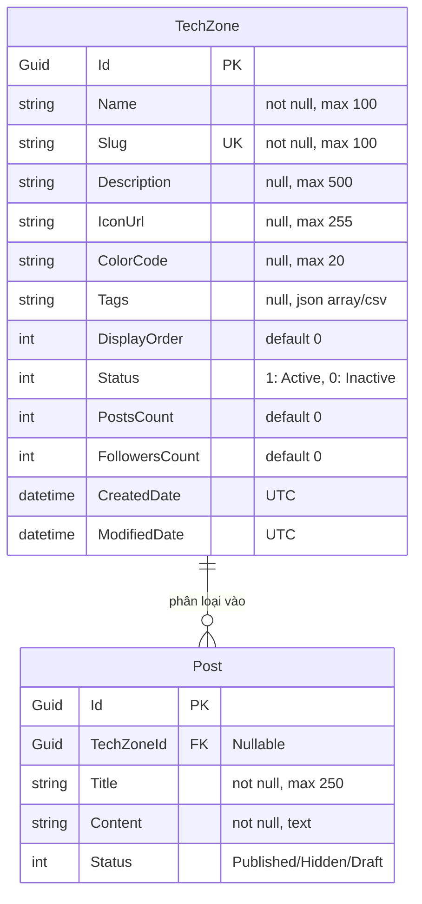
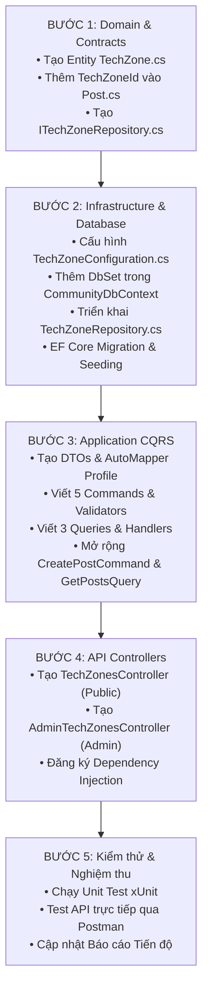

# KẾ HOẠCH BỔ SUNG MODULE TECHZONE TRONG COMMUNITY SERVICE
> **Dịch vụ:** `CommunityService` (ASP.NET Core 10 / Clean Architecture)  
> **Căn cứ tài liệu:** [DevRadar_SRS.pdf](file:///d:/Project/DevRadar/docs/workflow/DevRadar_SRS.pdf) và [DevRadar_SDD.pdf](file:///d:/Project/DevRadar/docs/workflow/DevRadar_SDD.pdf)  
> **Mục tiêu:** Đáp ứng toàn diện 7 Ca sử dụng: **UC-14** (Khám phá TechZone) và **UC-69 → UC-74** (Admin Quản lý TechZone).  
> **Wireframe tham chiếu:** [SCR-06](file:///d:/Project/DevRadar/docs/ui/designs/wireframes/SCR-06_TechZones_Wireframe_Grayscale.svg) (Client Explorer) & [SCR-21](file:///d:/Project/DevRadar/docs/ui/designs/wireframes/SCR-21_AdminTechZones_Wireframe_Grayscale.svg) (Admin Config).  
> **Thời điểm lập kế hoạch:** Tháng 10 / 2026  

---

## MỤC LỤC
1. [Mục tiêu và Phạm vi](#1-mục-tiêu-và-phạm-vi)
2. [Thiết kế Dữ liệu & Miền nghiệp vụ (Domain & Data Modeling)](#2-thiết-kế-dữ-liệu--miền-nghiệp-vụ)
3. [Thiết kế Clean Architecture & CQRS](#3-thiết-kế-clean-architecture--cqrs)
4. [Danh mục API Endpoints & Routing Gateway](#4-danh-mục-api-endpoints--routing-gateway)
5. [Kế hoạch Triển khai từng bước (Phase-by-Phase Execution)](#5-kế-hoạch-triển-khai-từng-bước)
6. [Dữ liệu mồi mặc định (Seed Data)](#6-dữ-liệu-mồi-mặc-định-seed-data)
7. [Kiểm thử & Tiêu chí nghiệm thu (Testing & Acceptance Criteria)](#7-kiểm-thử--tiêu-chí-nghiệm-thu)

---

## 1. MỤC TIÊU VÀ PHẠM VI

### 1.1. Ma trận 7 Ca sử dụng (Use Cases) giải quyết
| Mã UC | Tên Ca Sử Dụng | Tác Nhân | Trách Nhiệm Chi Tiết |
| :---: | :--- | :--- | :--- |
| **UC-14** | Khám phá TechZone | Guest / User | Hiển thị danh mục các Zone công nghệ, xem danh sách bài viết theo từng Zone (SCR-06). |
| **UC-69** | Xem danh sách TechZone (Admin) | Admin | Tra cứu bảng TechZones phân trang, tìm kiếm theo tên, slug, trạng thái kích hoạt (SCR-21). |
| **UC-70** | Tạo mới TechZone | Admin | Tạo Zone mới: Tên, Slug, Icon, Mô tả, Màu sắc, Thứ tự hiển thị, Mapped Tags. |
| **UC-71** | Chỉnh sửa TechZone | Admin | Cập nhật thông tin chi tiết và cấu hình của một TechZone. |
| **UC-72** | Ẩn / Kích hoạt TechZone | Admin | Chuyển đổi trạng thái Active / Inactive (ẩn khỏi bảng tin khám phá mà không mất dữ liệu). |
| **UC-73** | Xóa TechZone | Admin | Xóa Zone (kiểm tra an toàn dữ liệu: chỉ cho phép xóa khi không còn bài viết ràng buộc). |
| **UC-74** | Quản lý công nghệ trong TechZone | Admin | Gán, cập nhật danh sách Tags/Frameworks thuộc Zone (ví dụ: `.NET` ánh xạ `#csharp`, `#aspnet`, `#efcore`). |

---

## 2. THIẾT KẾ DỮ LIỆU & MIỀN NGHIỆP VỤ

### 2.1. Sơ đồ thực thể quan hệ (ERD)


### 2.2. Chi tiết thực thể `TechZone.cs`
- **Vị trí file:** `CommunityService/src/Community.Domain/Entities/TechZone.cs`
- **Kế thừa:** `AuditableEntity<Guid>`
- **Các thuộc tính:**
  ```csharp
  namespace Community.Domain.Entities;

  [Table("TechZones")]
  public class TechZone : AuditableEntity<Guid>
  {
      public string Name { get; set; } = string.Empty;
      public string Slug { get; set; } = string.Empty;
      public string? Description { get; set; }
      public string? IconUrl { get; set; }
      public string? ColorCode { get; set; }
      public string? Tags { get; set; } // Ví dụ: "dotnet,csharp,aspnet,efcore"
      public int DisplayOrder { get; set; } = 0;
      public int Status { get; set; } = 1; // 1 = Active, 0 = Inactive
      public int PostsCount { get; set; } = 0;
      public int FollowersCount { get; set; } = 0;

      public virtual ICollection<Post>? Posts { get; set; }
  }
  ```

### 2.3. Cập nhật thực thể `Post.cs`
Bổ sung trường liên kết:
```csharp
public Guid? TechZoneId { get; set; }
public virtual TechZone? TechZone { get; set; }
```

---

## 3. THIẾT KẾ CLEAN ARCHITECTURE & CQRS

Cấu trúc thư mục mới trong `Community.Application`:
```
Community.Application/
├── DTOs/
│   └── TechZone/
│       ├── TechZoneDto.cs
│       ├── TechZoneDetailDto.cs
│       ├── CreateTechZoneDto.cs
│       └── UpdateTechZoneDto.cs
└── Features/
    └── TechZones/
        ├── Commands/
        │   ├── CreateTechZone/
        │   │   ├── CreateTechZoneCommand.cs
        │   │   └── CreateTechZoneCommandValidator.cs
        │   ├── UpdateTechZone/
        │   │   ├── UpdateTechZoneCommand.cs
        │   │   └── UpdateTechZoneCommandValidator.cs
        │   ├── ToggleTechZoneStatus/
        │   │   └── ToggleTechZoneStatusCommand.cs
        │   ├── DeleteTechZone/
        │   │   └── DeleteTechZoneCommand.cs
        │   └── UpdateTechZoneTags/
        │       └── UpdateTechZoneTagsCommand.cs
        └── Queries/
            ├── GetActiveTechZones/
            │   └── GetActiveTechZonesQuery.cs
            ├── GetTechZoneBySlug/
            │   └── GetTechZoneBySlugQuery.cs
            └── GetAdminTechZones/
                └── GetAdminTechZonesQuery.cs
```

### 3.1. Các Commands chi tiết
1. **`CreateTechZoneCommand`**:
   - Tham số: `Name`, `Slug`, `Description`, `IconUrl`, `ColorCode`, `Tags`, `DisplayOrder`.
   - Logic: Tự động chuyển slug về lowercase không dấu; kiểm tra tính duy nhất (`Slug` không được trùng).
2. **`UpdateTechZoneCommand`**:
   - Tham số: `Id`, `Name`, `Description`, `IconUrl`, `ColorCode`, `DisplayOrder`.
   - Logic: Tìm theo `Id`, kiểm tra tồn tại, cập nhật thuộc tính.
3. **`ToggleTechZoneStatusCommand`**:
   - Tham số: `Id`.
   - Logic: Đảo ngược trạng thái `Status = (Status == 1 ? 0 : 1)`.
4. **`DeleteTechZoneCommand`**:
   - Tham số: `Id`.
   - Logic: Kiểm tra nếu `PostsCount > 0` hoặc có bài viết liên kết trong bảng `Posts` thì từ chối xóa (báo lỗi `ValidationException: Không thể xóa TechZone đang chứa bài viết`).
5. **`UpdateTechZoneTagsCommand`**:
   - Tham số: `Id`, `Tags` (mảng string).
   - Logic: Chuẩn hóa mảng tag và lưu vào trường `Tags`.

### 3.2. Các Queries chi tiết
1. **`GetActiveTechZonesQuery`** (Client):
   - Logic: Lấy các bản ghi có `Status == 1`, sắp xếp theo `DisplayOrder ASC`, trả về danh sách `TechZoneDto`.
2. **`GetTechZoneBySlugQuery`** (Client):
   - Logic: Lấy chi tiết zone theo `Slug`, kèm bài viết mới nhất thuộc zone đó.
3. **`GetAdminTechZonesQuery`** (Admin):
   - Logic: Nhận tham số tìm kiếm `SearchTerm`, lọc theo `Status`, phân trang `PageNumber`, `PageSize`, trả về `PagedResponse<TechZoneDetailDto>`.

---

## 4. DANH MỤC API ENDPOINTS & ROUTING GATEWAY

### 4.1. Client Endpoints (`api/techzones`) — Không yêu cầu xác thực / Người dùng đã đăng nhập
| Phương thức | Tuyến đường (Route) | Mô tả | UC Đáp Ứng |
| :---: | :--- | :--- | :---: |
| `GET` | `/api/techzones` | Lấy danh sách các TechZone đang kích hoạt | UC-14 |
| `GET` | `/api/techzones/{slug}` | Xem chi tiết TechZone theo slug thân thiện | UC-14 |
| `GET` | `/api/posts?techZoneSlug={slug}` | Lọc bài viết thuộc TechZone cụ thể | UC-14, UC-13 |

### 4.2. Admin Endpoints (`api/admin/techzones`) — Yêu cầu `[Authorize(Roles = "Admin")]`
| Phương thức | Tuyến đường (Route) | Mô tả | UC Đáp Ứng |
| :---: | :--- | :--- | :---: |
| `GET` | `/api/admin/techzones` | Bảng quản trị danh sách TechZone kèm phân trang & search | UC-69 |
| `POST` | `/api/admin/techzones` | Tạo mới một TechZone | UC-70 |
| `PUT` | `/api/admin/techzones/{id:guid}` | Cập nhật thông tin TechZone | UC-71 |
| `PATCH` | `/api/admin/techzones/{id:guid}/toggle-status` | Bật / tắt trạng thái hiển thị của TechZone | UC-72 |
| `DELETE` | `/api/admin/techzones/{id:guid}` | Xóa vĩnh viễn TechZone khi không còn ràng buộc | UC-73 |
| `PUT` | `/api/admin/techzones/{id:guid}/tags` | Cập nhật danh sách công nghệ/tags của TechZone | UC-74 |

### 4.3. Gateway Định tuyến (`GatewayService`)
Gateway đã có rule chuyển tiếp trong `yarp.json`:
- Tuyến `/community/{**catch-all}` tự động chuyển tiếp tới `community-cluster:5145`.
- Do đó:
  - Client gọi: `http://localhost:5000/community/api/techzones`
  - Admin gọi: `http://localhost:5000/community/api/admin/techzones`
  - **Không cần sửa đổi bất kỳ cấu hình nào trên YARP Gateway.**

---

## 5. KẾ HOẠCH TRIỂN KHAI TỪNG BƯỚC



---

## 6. DỮ LIỆU MỒI MẶC ĐỊNH (SEED DATA)

Khi chạy Migration ban đầu, hệ thống sẽ tự động nạp 6 TechZone tiêu chuẩn:

| Tên TechZone | Slug | Mã Màu | Tags Liên Kết | Thứ Tự |
| :--- | :--- | :--- | :--- | :---: |
| **.NET Core & C#** | `dotnet` | `#512BD4` | `dotnet, csharp, aspnet, efcore, blazor` | 1 |
| **AI & Data Engineering** | `ai-data` | `#FF6F00` | `python, machine-learning, deep-learning, pytorch, rag, llm` | 2 |
| **Frontend & UI/UX** | `frontend` | `#61DAFB` | `react, nextjs, vue, angular, tailwindcss, typescript` | 3 |
| **Cloud & DevOps** | `devops-cloud` | `#2496ED` | `docker, kubernetes, cicd, aws, azure, terraform` | 4 |
| **Backend & Distributed Systems** | `backend` | `#00ADD8` | `microservices, golang, rust, rabbitmq, kafka, redis` | 5 |
| **Mobile Development** | `mobile` | `#02569B` | `flutter, react-native, kotlin, swift, ios, android` | 6 |

---

## 7. KIỂM THỬ & TIÊU CHÍ NGHIỆM THU

### 7.1. Tiêu chí nghiệm thu chức năng
1. **Client:**
   - [x] Khách và thành viên truy cập `GET /api/techzones` nhận danh sách đầy đủ 6 zones.
   - [x] Lọc bài viết qua `GET /api/posts?techZoneSlug=dotnet` chỉ trả về bài viết thuộc Zone .NET.
   - [x] Tạo bài viết mới kèm `techZoneId` hợp lệ được lưu chính xác và tăng `PostsCount`.
2. **Admin:**
   - [x] Admin tạo mới TechZone với slug duy nhất thành công.
   - [x] Cấm tạo TechZone có slug trùng lặp (trả về lỗi HTTP 400).
   - [x] Ẩn TechZone làm Zone đó không còn xuất hiện trong API Client nhưng vẫn hiển thị trên API Admin.
   - [x] Xóa TechZone đang có bài viết bị chặn với thông báo lỗi thích hợp.

### 7.2. Tác động tới Báo cáo Tiến độ tổng thể
Sau khi hoàn thành module TechZone:
- Số Use Case hoàn thành tăng từ **36/81 (44.4%)** lên **43/81 (53.1%)**.
- Tiến độ `CommunityService` tăng từ **35.3%** lên **55.9%**.
